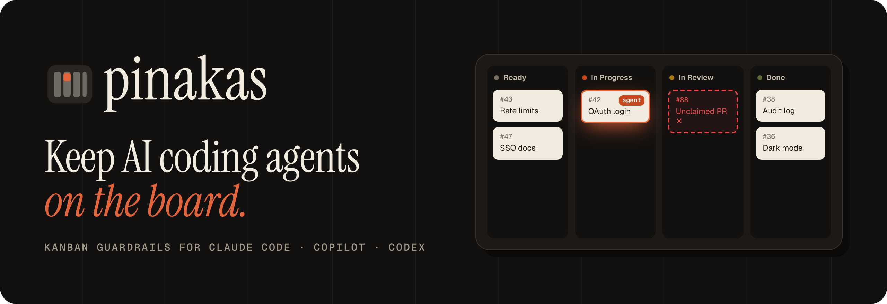
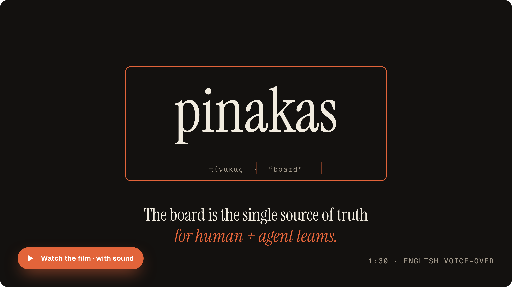
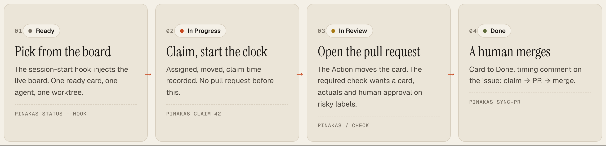

<p align="center">
  <a href="https://mmornati.github.io/pinakas/"></a>
</p>

<p align="center">
  <a href="https://github.com/mmornati/pinakas/actions/workflows/ci.yml"></a>
  <a href="https://github.com/mmornati/pinakas/releases/latest"></a>
  <a href="go.mod"></a>
  <a href="LICENSE"></a>
  <a href="https://mmornati.github.io/pinakas/"></a>
</p>

<p align="center">
  <a href="https://mmornati.github.io/pinakas/"><b>Website</b></a> ·
  <a href="https://mmornati.github.io/pinakas/#film"><b>The film (1:40)</b></a> ·
  <a href="https://mmornati.github.io/pinakas/docs/"><b>Documentation</b></a> ·
  <a href="#quick-start"><b>Quick start</b></a> ·
  <a href="CONTRIBUTING.md"><b>Contributing</b></a>
</p>

---

**pinakas** (Greek πίνακας, *board*) makes a Kanban board the single source of truth for human + agent teams. Agents claim cards, move them and record what each story really cost. Hooks and CI checks make sure they can't skip a step.

<p align="center">
  <a href="https://mmornati.github.io/pinakas/#film"></a>
</p>

## Why

Running coding agents from a Kanban board works: stories ship **3 to 6 times faster** than estimated. But left alone, agents drift:

- ✕ **Cards never move.** The PR merged on Tuesday; the card still says In Progress.
- ✕ **PRs nobody claimed.** An agent opens a pull request for a story it picked on its own.
- ✕ **No record of the cost.** The session ends without duration, tokens or review findings.

> A skill can describe the workflow. It can't enforce it. **pinakas does.**

## How it works

<picture>
  <source media="(prefers-color-scheme: dark)" srcset=".github/assets/lifecycle-dark.png">
  
</picture>

| Layer | What it does | Since |
| --- | --- | --- |
| **`pinakas` CLI** | Gives agents write access to the board: `claim`, `move`, `actuals`, `status`, `release` | v0.1 |
| **Agent hooks** | Session start injects the live board, a pre-tool hook blocks `gh pr create` for an unclaimed card, a stop hook blocks finishing without actuals. Claude Code, GitHub Copilot and Codex | v0.1, Copilot v0.2, Codex v0.3 |
| **GitHub Action** | Moves the card when a PR opens, goes back to draft or merges, and records durations from timestamps | v0.2 |
| **Required check** | PR closes a card of the board, the card has actuals, risky labels have a human approval | v0.2 |
| **Metrics** | `pinakas report` per story and in aggregate: agent time, tokens, first pass, findings, lead time, defects within 30 days | v0.3 |

All logic lives in the CLI. Each agent tool gets a one-line hook that calls it, so there is one implementation to maintain and a few small wiring files.

### Hooks that say no, and say why

A blocked agent gets the exact command that unblocks it, so it corrects itself instead of giving up.

```console
$ gh pr create --fill
✕ blocked by pinakas check-pr
pinakas: no card is claimed in this working tree. Run `pinakas status` to pick an
unblocked card, then `pinakas claim <issue>` before opening a pull request.
```

```console
● agent is about to finish
✕ blocked by pinakas check-stop
pinakas: card #42 (Add OAuth login) has no actuals yet. Record them with
`pinakas actuals 42 --tokens <n> --first-pass=<yes|no>` before stopping,
or `pinakas release` if the card is abandoned.
```

## Quick start

Requirements: the [GitHub CLI](https://cli.github.com) signed in with the `project` scope, and a GitHub Project (v2) with a single-select `Status` field. Go 1.27+ only if you install with `go install`.

```sh
# 1. Install the CLI: a prebuilt binary from the releases page
#    (https://github.com/mmornati/pinakas/releases), or with Go
go install github.com/mmornati/pinakas/cmd/pinakas@latest
gh auth refresh -s project

# 2. Configure your repository
pinakas init --owner <user-or-org> --project <number> --repo <owner/name>
pinakas status
```

```text
# 3. Install the Claude Code plugin (skills + hooks), inside Claude Code
/plugin marketplace add mmornati/pinakas
/plugin install pinakas@pinakas
```

Then ask your agent to pick the next ready story.

<details>
<summary><b>GitLab</b></summary>

```sh
export GITLAB_TOKEN=<token with the api scope>
pinakas init --provider gitlab --repo <group/project> [--url https://gitlab.example.com] [--owner <group>]
pinakas status
```

On GitLab a column is a label, as on a GitLab issue board: `workflow::ready`, `workflow::in progress`, `workflow::review` and `workflow::done` by default (scoped labels keep one column per issue). `move` swaps the label; moving to done closes the issue and moving out of it reopens it. With `--owner <group>`, the board spans every project of the group. The hooks also guard `glab mr create`. The GitHub Action and the required check are GitHub-only for now.

</details>

<details>
<summary><b>GitHub Copilot</b></summary>

```sh
pinakas init --copilot   # writes .github/hooks/pinakas.json
```

Copilot CLI and the Copilot cloud agent load repository hooks from `.github/hooks/`. The cloud agent also needs `pinakas` on its path and a token for the board: install it in `.github/workflows/copilot-setup-steps.yml` (`go install github.com/mmornati/pinakas/cmd/pinakas@v0.3.1`) and expose `GH_TOKEN`.

</details>

<details>
<summary><b>Codex</b></summary>

```sh
pinakas init --codex     # writes .codex/hooks.json and .agents/skills/pinakas-*
```

Codex loads project hooks from `.codex/hooks.json` once the project is trusted, and runs a hook only after you review it: open `/hooks` in Codex and trust the three pinakas hooks (again after any change to them). The hooks use `--format codex`; the skills are the same as in the Claude Code plugin.

</details>

<details>
<summary><b>Board sync and required check</b></summary>

```sh
pinakas init --workflow  # writes .github/workflows/pinakas.yml
```

1. Create a `PINAKAS_TOKEN` secret that can reach the project: a classic PAT with the `project` and `repo` scopes, or a GitHub App token. `GITHUB_TOKEN` cannot read projects owned by a user.
2. Make `pinakas / check` a required status check in the branch protection of your default branch.

| Pull request event | Card |
| --- | --- |
| Opened, reopened, ready for review, description edited | Moved to review |
| Converted to draft | Moved back to in progress |
| Merged | Moved to done, timing comment posted (claim to PR, PR to merge, claim to merge) |
| Closed without merge | Left where it is |

The check fails when the description closes no card of the board (`Closes #42`), when a linked card has no actuals, or when a label from `rules.approval_labels` has no approving review from a human other than the author. Reviews re-run it. Secrets are not available to pull requests from forks, so the workflow is meant for branches of the repository itself.

</details>

## Commands

| Command | What it does |
| --- | --- |
| `pinakas status [--json\|--mine\|--hook]` | Board grouped by column, plus the card claimed in this working tree |
| `pinakas claim <issue>` | Assign a **Ready** card to you, move it to **In Progress**, start the clock |
| `pinakas move <issue> <column>` | Move a card (`ready`, `in_progress`, `review`, `done` or a column name) |
| `pinakas actuals [issue] --tokens N --first-pass yes --findings major=1,minor=3` | Post the story's actuals as an issue comment |
| `pinakas release [--to ready] [--keep-assignee]` | Drop the claim without actuals and unassign yourself |
| `pinakas defect <story> <bug> [--at 2026-11-20] [--note ...]` | Link a bug back to the story that introduced it |
| `pinakas report [--since 30d] [--status done,review\|--all] [--measured] [--format table\|json\|csv\|markdown]` | Per-story metrics and a summary; the done column by default |
| `pinakas mcp` | MCP server over stdio for any MCP client (see below) |
| `pinakas check-pr` / `pinakas check-stop` `[--format claude\|copilot\|codex]` | Hook entry points. Claude Code: exit 2 with the reason on stderr. Copilot and Codex: a deny or block decision as JSON |
| `pinakas sync-pr` / `pinakas check-ci` | GitHub Action entry points, reading `GITHUB_EVENT_PATH` |
| `pinakas init [--provider gitlab] [--copilot] [--codex] [--workflow]` | Write `.pinakas.yml`, the Copilot or Codex hooks and the workflow; never overwrites |

Issues can be written `42`, `#42` or `owner/name#42`. The claim is stored inside the git directory, so each worktree (and each parallel agent) tracks its own card and nothing gets committed.

## MCP server

`pinakas mcp` serves the board to any MCP client over stdio, for agents that have no shell or should not get one. Tools: `board_status`, `claim_card`, `move_card`, `record_actuals`, `release_card`, `story_report`, `link_defect`. Each tool runs the matching command, with the same rules (only ready cards, one open claim per working tree). Start it from the repository, so that it finds `.pinakas.yml` and the working tree's claim.

```sh
claude mcp add pinakas -- pinakas mcp          # Claude Code
```

```toml
# Codex: ~/.codex/config.toml
[mcp_servers.pinakas]
command = "pinakas"
args = ["mcp"]
```

```json
{ "mcpServers": { "pinakas": { "command": "pinakas", "args": ["mcp"] } } }
```

The hooks still guard pull requests and stops; MCP only gives the agent the board.

## Configuration

`.pinakas.yml` at the repository root:

```yaml
board:
  provider: github
  owner: acme
  project: 3
  repo: acme/app
  status_field: Status
  columns:
    ready: Ready
    in_progress: In Progress
    review: In Review
    done: Done
rules:
  require_claim_before_pr: true        # hook: no PR without a claimed card
  require_actuals_before_stop: true    # hook: no stop without actuals
  require_linked_issue: true           # check: PR must close a card
  require_actuals_on_pr: true          # check: linked cards need actuals
  approval_labels: ["risk:high"]       # check: these labels need a human approval
  exempt_authors: ["dependabot[bot]", "renovate[bot]"]
```

## Measuring

Every story records the same fields so that experiments can be compared:

| Duration | Tokens | First pass | Findings |
| --- | --- | --- | --- |
| From claim to actuals, from timestamps | Reported by the agent | Did review pass without changes? | Review findings by severity |

At merge, the Action adds durations measured from timestamps only, independent of what the agent reports. When a bug traces back to a delivered story, `pinakas defect <story> <bug>` links them, so that fast but fragile stories show up.

```console
$ pinakas report --since 30d
Story        Title          Delivered   Agent time  Tokens  First pass  Findings  Lead time  Review  Defects 30d
acme/app#41  Login form     2026-11-02  45 min      182000  yes         minor=2   2 h 10     1 h 25  1
acme/app#44  Session reset  2026-11-20  20 min      64000   no          major=1   1 h 05     40 min  0 (open)

Stories: 2 (2 with actuals)
Median agent time: 33 min
...
Stories with a defect: 100% of 1 stories with a closed window
```

The report reads the done column by default (`--status`, `--all` to widen it) and prints a table, JSON, CSV or Markdown. A story is delivered at merge, or when its actuals were recorded if there is no merge. Its defects count when found within 30 days of delivery, and the defect rate only uses stories whose 30-day window has ended. The Action runs it too, for a weekly summary:

```yaml
on:
  schedule: [{ cron: "0 7 * * 1" }]
jobs:
  report:
    runs-on: ubuntu-latest
    steps:
      - uses: actions/checkout@v7
      - uses: mmornati/pinakas@v0.3.1
        with:
          command: report
          args: --since 7d
          token: ${{ secrets.PINAKAS_TOKEN }}
```

Actuals, timing and defect comments carry a machine-readable marker that the report and the CI check parse back.

> [!NOTE]
> GitHub Projects has built-in workflows that close an issue when its item moves to Done. pinakas does not need them, and defects are linked with `pinakas defect` rather than by reopening the story, so either setting works; turn the "Auto-close issue" workflow off in the project's Workflows tab if you want Done to mean "merged" only.

## Guardrails are fail-open

A broken guardrail must never stop all work. If the hook input is malformed or the board can't be reached, pinakas prints a warning and checks only what it can verify locally. Outside a repository with `.pinakas.yml`, the hooks do nothing.

## Supported tools

| Tool | Status |
| --- | --- |
| Claude Code | ✅ plugin (skills + hooks), v0.1 |
| GitHub Copilot | ✅ repository hooks (`.github/hooks`), v0.2 |
| GitHub Projects | ✅ board backend, v0.1 |
| Codex | ✅ project hooks (`.codex/hooks.json`) and skills (`.agents/skills`), v0.3 |
| MCP clients | ✅ `pinakas mcp` (stdio), v0.4 |
| GitLab | ✅ board backend (labels as columns), hooks guard `glab mr create`, v0.4 |

## Roadmap

- [x] **v0.1** CLI on GitHub Projects, Claude Code plugin with two skills and three hooks.
- [x] **v0.2** GitHub Action for card moves and durations, required CI check, Copilot wiring.
- [x] **v0.3** Per-story metrics schema, `pinakas report`, Codex adapter.
- [ ] **v0.4** GitLab backend, MCP server.
- [ ] **v1.0** Stable config schema, complete docs, example project, signed releases.

## Contributing

Issues and pull requests are welcome. Read [CONTRIBUTING.md](CONTRIBUTING.md) to get started, and the [Code of Conduct](CODE_OF_CONDUCT.md). Report vulnerabilities privately as described in [SECURITY.md](SECURITY.md).

```sh
go test -race ./...
golangci-lint run
```

Releases: create a GitHub release with a `vX.Y.Z` tag. The `release` workflow runs GoReleaser and attaches binaries for Linux, macOS and Windows (amd64 and arm64) plus checksums, keeping the notes written on the release page.

## Background

pinakas grew out of running real projects with a human + agent Kanban workflow; see [blog.mornati.net](https://blog.mornati.net).

## License

[Apache 2.0](LICENSE) © Marco Mornati

<p align="center"><br><a href="https://mmornati.github.io/pinakas/"></a></p>
